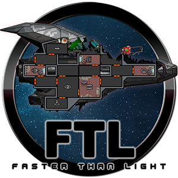

<div align="center">



# FTL: Faster Than Light — браузерная демо-версия

**Официальная демо-версия FTL, которая запускается прямо в браузере — без установки и плагинов.**

*Спасите Федерацию от повстанцев и прыгайте быстрее света.*

[](https://USERNAME.github.io/ftldemo/)


</div>

---

## 🚀 Об игре

**FTL: Faster Than Light** — «космический симулятор-рогалик» от Subset Games. Вы командуете кораблём Федерации, который несёт важные данные через случайно сгенерированную галактику, а по пятам идёт флот повстанцев. Каждый прыжок — новая встреча, каждое решение может стать последним.

| | |
|---|---|
| 🧠 **Стратегия в реальном времени** | Отдавайте приказы экипажу, распределяйте энергию между системами и выбирайте цели для оружия прямо в бою. |
| ⏸️ **Играйте в своём темпе** | Ставьте игру на паузу посреди сражения, чтобы спокойно продумать тактику. |
| 👽 **Инопланетные расы** | Улучшайте корабль и открывайте новые с помощью разных инопланетных рас. |
| 📜 **Сотни событий** | Текстовые встречи заставляют принимать непростые решения. |
| 🌌 **Случайная галактика** | Враги, события и последствия каждый раз разные — двух одинаковых прохождений не бывает. |
| 💀 **Без второго шанса** | Permadeath: погибли — начинайте заново. |

## 🕹️ О сборке

Это та самая браузерная демо-версия, которую Humble Bundle выпустил в октябре 2014 года вместе с Mozilla: оригинальная игра на C++, скомпилированная в **asm.js** через **Emscripten**. Работает в любом современном браузере с поддержкой WebGL.

- 🎵 34 трека саундтрека **Ben Prunty** в формате OGG
- 🖥️ Полноэкранный режим с корректным масштабированием
- 🔒 Демо-режим: по окончании пробной части игра предложит купить полную версию

## ▶️ Как запустить

### Онлайн

Просто откройте **[USERNAME.github.io/ftldemo](https://USERNAME.github.io/ftldemo/)**.

### Локально

Игра загружает свои данные через XHR, поэтому `index.html`, открытый двойным щелчком (`file://`), работать не будет — нужен любой локальный веб-сервер:

```bash
git clone https://github.com/USERNAME/ftldemo.git
cd ftldemo
python -m http.server 8000
```

Затем откройте <http://localhost:8000> в браузере.

### Свой GitHub Pages

1. Сделайте форк репозитория.
2. **Settings → Pages → Source:** `Deploy from a branch`, ветка `main`, папка `/ (root)`.
3. Через пару минут игра будет доступна по адресу `https://<ваш-ник>.github.io/ftldemo/`.

## 📁 Структура проекта

```
ftldemo/
├── index.html                    # страница-плеер
├── FTL-1413323248.js             # движок игры (asm.js)
├── FTL-1413323248.js.mem         # начальная память
├── FTL-1413323248.data           # графика и игровые данные (~54 МБ)
├── FTL-audio-1413323248.data     # звуковые эффекты (~12 МБ)
├── music/                        # саундтрек, 34 × .ogg (~130 МБ)
├── main.min.js, 19d6f4….js       # загрузчик и плеер Humble
├── *.css, *.woff2, *.svg, *.png  # стили, шрифты и иконки интерфейса
└── ftlicon.png                   # иконка
```

## 💻 Требования

- Браузер с поддержкой WebGL: Chrome, Firefox, Edge, Safari (актуальные версии)
- ~200 МБ трафика при первом запуске
- Мышь и клавиатура

## ⚖️ Правовая информация

**FTL: Faster Than Light** © [Subset Games](https://subsetgames.com/). Все права на игру, графику, музыку и торговые марки принадлежат их владельцам. Браузерная демо-версия распространялась бесплатно через Humble Bundle.

Репозиторий не связан с Subset Games и Humble Bundle и не одобрен ими. Если игра понравилась — поддержите разработчиков и купите полную версию **FTL: Advanced Edition**:

<div align="center">

[](https://store.steampowered.com/app/212680/)
[](https://www.gog.com/game/faster_than_light)
[](https://www.humblebundle.com/store/ftlfasterthanlight)

<sub>Сделано с ❤️ для любителей космоса</sub>

</div>
